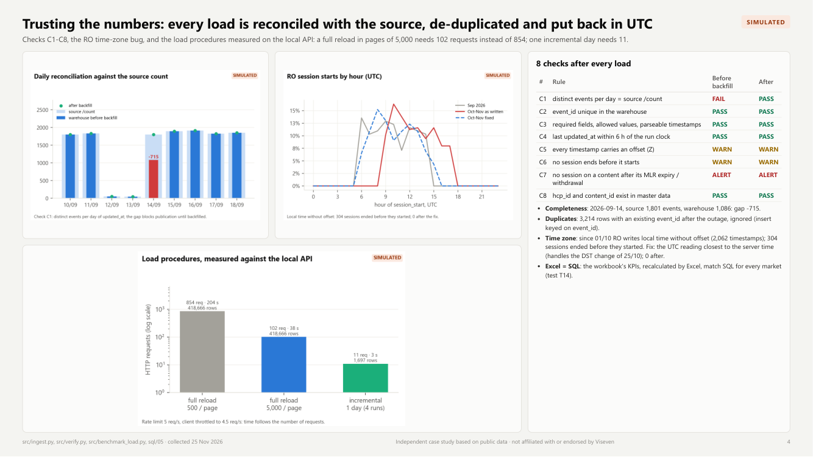

# Viseven: content-engagement reports that clients can trust

**[Read the report (PDF)](https://albt-france.github.io/viseven-content-reporting-case-study/report/viseven_data_analyst_case_study.pdf) · [Open the interactive dashboard](https://albt-france.github.io/viseven-content-reporting-case-study/dashboard/)**

<sub>Fallback links in the repository: [site/report/viseven_data_analyst_case_study.pdf](site/report/viseven_data_analyst_case_study.pdf) · [site/dashboard/index.html](site/dashboard/index.html) (download and open locally)</sub>

An independent case study for the **Data Analyst (Freelance)** role at Viseven. The question: how do you deliver a pharma client a monthly report on its omnichannel content (remote e-detailing, approved emails, webinars) where **every number is defined, verified, reloadable and documented**, even when the source breaks?

- **PUBLIC DATA**: what Viseven publishes about itself, the Estonian business register, npm activity of `ewizard-cli`, practising physicians (Eurostat), EU medicines (Source: European Medicines Agency), recruiting clinical trials (ClinicalTrials.gov REST API), public holidays.
- **SIMULATED**: "Client P", a fictional pharma company in 8 markets (RO, PL, FR, DE, ES, IT, BG, UA), Dec 2025 - Nov 2026: 6,000 HCPs (identifiers only), 120 contents, 418,666 events served by a **local REST API** with pagination, rate limit and an outage. Not data of Viseven or of any company; the API is **not** the API of eWizard or of any Viseven product.

## Key results
1. **Engagement time was 38% too high.** Forgotten tabs (617 of 35,097 e-detail sessions) made the naive average 3.21 min per session; capped at the last slide + 30 s it is **2.32 min**.
2. **The old report rewrote the past.** Filtering contents on today's status erased the history of every content withdrawn or expired since: March 2026 fell from 3,746 sessions (published 1 Apr) to 2,360 (25 Nov). With the status valid at the event time it stays at 3,775.
3. **A 6-hour outage cost 715 events, then 0.** On 14/09/2026 a failed run moved the load watermark anyway; the daily reconciliation against the source count caught the gap, a backfill recovered all 715 events, and the fixed job (watermark only after a verified batch) loses none when the day is replayed. 3,214 duplicate rows were ignored by an insert keyed on `event_id`.
4. **One real alert, one false alarm.** 412 sessions used 2 contents up to 19 days after their MLR expiry (flagged, excluded from KPIs). The -31% August dip is not a tracking failure: per working day it is -24.8%, like -26.2% in August 2025.



## What is in the repository
| Area | Files |
|---|---|
| Requirements (Agile) | [docs/report_request.md](docs/report_request.md): 1 Epic, 5 Stories, Given-When-Then scenarios |
| Indicators | [docs/kpi_definitions.md](docs/kpi_definitions.md), `sql/03_sessions.sql`, `sql/04_kpi.sql`, `sql/06_simpson_ctr.sql`, `sql/07_point_in_time_status.sql` |
| Loading | `src/mock_api.py`, `src/ingest.py` (full / incremental / backfill), `src/collect_trials.py` (real REST API), [docs/load_procedure.md](docs/load_procedure.md) with measured benchmark |
| Verification | `src/verify.py` (C1-C8), `sql/05_verification.sql`, `sql/99_tests.sql` (14 tests), [docs/verification_rules.md](docs/verification_rules.md) |
| Report | [excel/client_p_monthly_report.xlsx](excel/client_p_monthly_report.xlsx): real formulas (SUMIFS, COUNTIFS, XLOOKUP, IFERROR, LET), Verification sheet vs SQL |
| Incidents | [docs/incident_runbook.md](docs/incident_runbook.md), [docs/incident_report_2026-09-14.md](docs/incident_report_2026-09-14.md), [docs/data_issues_log.md](docs/data_issues_log.md) |
| Improvements | [docs/report_improvements.md](docs/report_improvements.md) (before / after) |
| Articles | [How we compute engagement time](docs/articles/how_we_compute_engagement_time.md) · [Why the report now uses point-in-time content status](docs/articles/why_point_in_time_content_status.md) |
| Other docs | [docs/assumptions.md](docs/assumptions.md), [docs/glossary.md](docs/glossary.md) |
| Notebook | [notebooks/viseven_data_analyst_case_study.ipynb](notebooks/viseven_data_analyst_case_study.ipynb) (executed) |

## Methods
- **Real REST load**: ClinicalTrials.gov API v2, token pagination, 1 request per second, limited fields (no investigator or contact data), retries with backoff and `Retry-After`, cache, and `totalCount` = rows received in all 8 markets (18,414 rows).
- **Simulation** (`src/simulate_client_p.py`, seed 42): HCPs split by Eurostat physician weights, brand areas from EMA authorisations, seasonality from real public holidays. Eight data situations are planted; all are found by the checks and tests.
- **Loads**: a local API (Python standard library, 127.0.0.1) with cursor pagination, 429 + `Retry-After` above 5 requests/s and HTTP 500 during an outage; full, incremental (6-hourly schedule replayed) and backfill loads into DuckDB; idempotent insert on `event_id`; every run logged.
- **SQL (DuckDB)**: sessionisation with window functions, KPIs with GROUPING SETS, point-in-time joins, ASOF joins, small-group suppression (no published cell under 5 HCPs), 14 assertions.
- **Excel**: KPIs as formulas over a Data sheet, recalculated by Excel and checked against Python and SQL (zero difference beyond SQL rounding).
- AI-assisted workflow: I used Claude, mainly to write scripts faster. I drove the project: I defined the questions, chose and validated the data sources, made the analytical decisions and checked every result.

## How to re-run
Python 3.10+, then `pip install -r requirements.txt`. `data/public/` is enough to re-run everything **without** collecting again (skip the first two commands). Run from the repository root, in this order:

```bash
python src/collect_public.py          # optional: Eurostat, EMA, npm, holidays, register, Lever, site facts
python src/collect_trials.py          # optional: ClinicalTrials.gov REST load (8 markets, ~1 min)
python src/simulate_client_p.py       # Client P source system (seed 42)
python src/mock_api.py                # in a second terminal: local API on 127.0.0.1:8765, leave it running
python src/ingest.py --full
python src/ingest.py --incremental --job v1     # replays the job as it ran in production, incl. the 14/09 outage
python src/verify.py --label before_backfill
python src/ingest.py --backfill --since 2026-09-14T03:00:00Z --until 2026-09-14T09:00:00Z
python src/verify.py --label after_backfill
python src/benchmark_load.py          # ~5 min, measures full vs incremental and v1 vs v2
python src/run_sql.py
python src/build_workbook.py          # recalculated by Excel if installed, else LibreOffice, else on opening
python src/check_workbook.py          # Excel vs Python vs SQL, then sql/99_tests.sql
python src/build_dashboard.py
python src/build_pdf.py               # needs Microsoft Edge or Chrome (headless print)
python src/build_notebook.py
```
`python src/ingest.py --incremental` (default `--job v2`) runs the fixed job. No API key is needed: the local API writes a dummy token to `.env` at start (`.env.example` shows the variable).

## Sources and licences
| Source | Use | Licence / attribution |
|---|---|---|
| viseven.com (home, careers, privacy policy), Lever postings | Company facts, the job | Quoted "as stated by Viseven", read 25 Nov 2026 |
| Estonian business register (ariregister.rik.ee) | Legal entity and status | Public register, company fields only |
| npm registry and downloads API | `ewizard-cli` activity | Public metadata; downloads include bots and CI (an activity index, not users or clients) |
| Eurostat `hlth_rs_prs2` | Practising physicians | Eurostat re-use policy |
| EMA medicines output report | EU authorisations | **Source: European Medicines Agency** (re-use with acknowledgement) |
| ClinicalTrials.gov API v2 | Recruiting trials | U.S. National Library of Medicine |
| Nager.Date | Public holidays | MIT |

## Limits
- Client P, its HCPs, contents, events and API are fictional. No internal data of Viseven is used or assumed, and none of its clients is named or guessed.
- The report measures engagement with content, not the effect of any medicine: no medical or regulatory advice.
- EMA counts only medicines still authorised (older years undercounted); a trial counts in every market where it has a site; therapeutic areas come from keyword grouping.
- Seconds in the benchmark were measured on one laptop; request counts are the robust part.

---
Independent case study based on public data · not affiliated with or endorsed by Viseven
